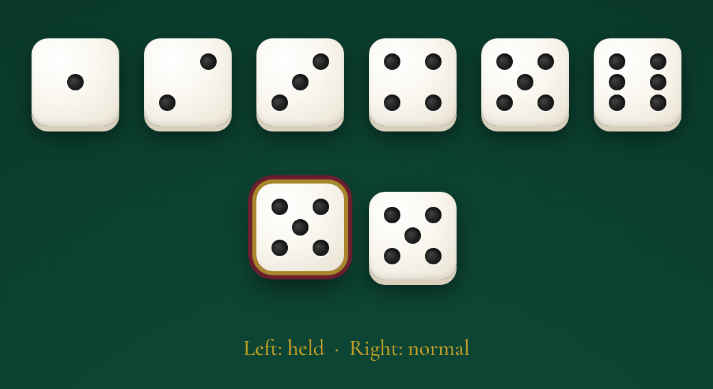
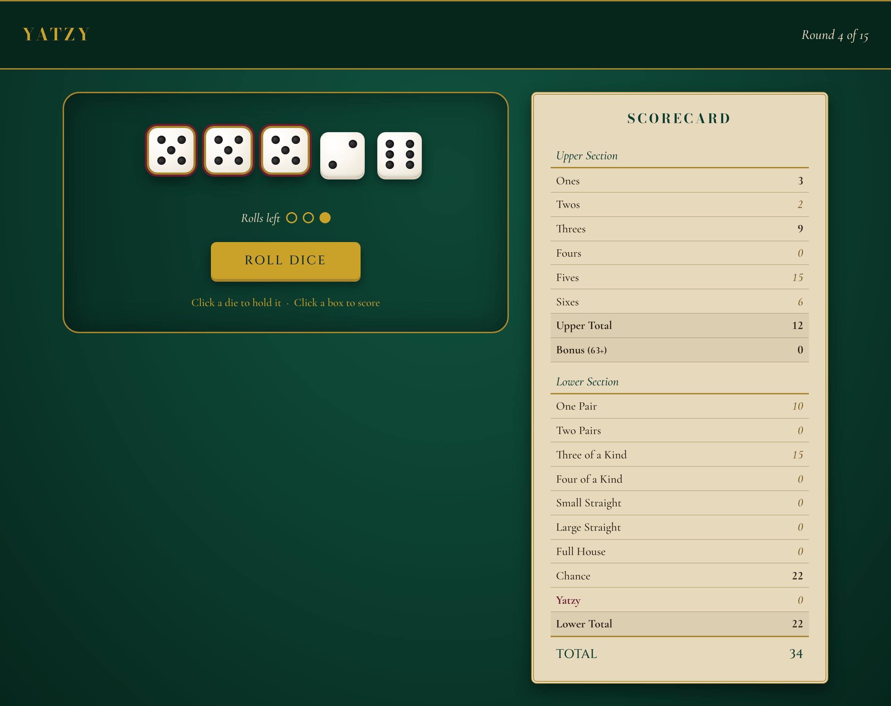
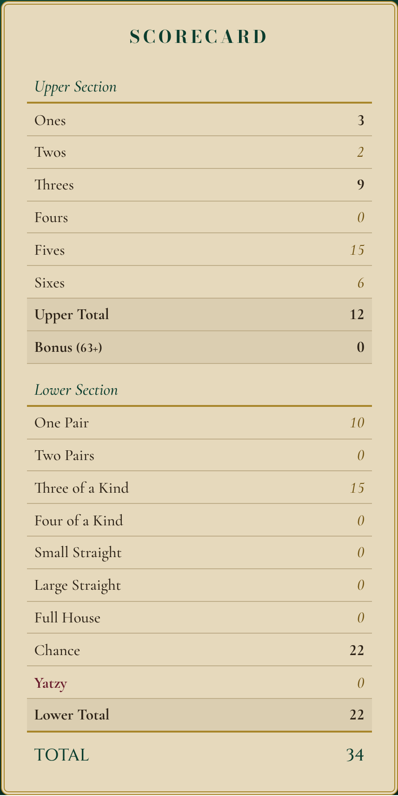
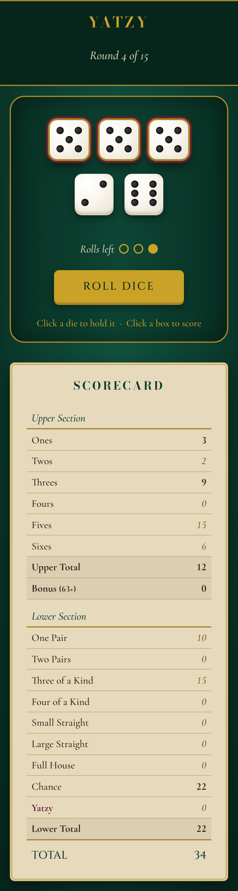

# Yatzy

A single-player Yatzy game built with HTML, CSS and Javascript for CST3106 Assignment 1. Roll five dice up to three times a turn, keep the ones you want, andscore them on a 15-box scorecard. The game ends after 15 rounds (or when you choose to end it) and shows your final score.

**Design direction:** a high-end casino table. Deep green felt, ivory dice, a parchment scorecard and gold accents.

---

## 1. Running the Game

The game uses JavaScript modules (`import` / `export`), which browsers only load from a web server, not from a file opened directly (`file://`).

1. Open the `yatzy` folder in VS Code.
2. Right-click `index.html` and choose **Open with Live Server**.
3. The game opens at `http://127.0.0.1:5500/index.html` or `http://localhost:5500/index.html`

---

## 2. How to Play

### Controls

| Control | What it does |
| --- | --- |
| **Roll Dice** | Rolls every die that isn't kept. Up to 3 rolls per turn. |
| **Click a die** | Keeps it (lifted with a brass and oxblood ring) so it isn't re-rolled. Click again to release it. |
| **Click a scorecard box** | Selects that box (oxblood bar). Click it again to unselect. |
| **End Turn** | Scores the dice in the selected box and starts the next round. |
| **End game** | Ends the game early, after confirming. Once the game is over it becomes **New game**. |
| **Play Again** | Starts a new game from the end-of-game screen. |

Everything also works with the keyboard: **Tab** moves between dice, buttons and open boxes, and **Enter** or **Space** clicks them.

### A Turn

1. Press **Roll Dice**.
2. Click any dice you want to keep, then roll again. You have 3 rolls; the gold markers show how many are left.
3. After each roll, every unused box shows a **preview** of what the dice would score there.
4. Click the box you want, then press **End Turn**. The score is locked in and the totals update.

Every turn has to score in one box. If the dice don't fit anything useful, you can take a 0 in any open box.

### Scoring

#### Upper Section

| Box | Score |
| --- | --- |
| Ones - Sixes | Sum of the dice showing that number |
| **Bonus** | **+50** if the upper section totals 63 or more (added automatically) |

#### Lower Section

| Box | Requirement | Score |
| --- | --- | --- |
| One Pair | Two dice the same | Sum of the highest pair |
| Two Pairs | Two different pairs | Sum of both pairs |
| Three of a Kind | Three dice the same | Sum of those three |
| Four of a Kind | Four dice the same | Sum of those four |
| Small Straight | 1-2-3-4-5 | 15 |
| Large Straight | 2-3-4-5-6 | 20 |
| Full House | Three of one number and two of another | Sum of all dice |
| Chance | Anything | Sum of all dice |
| Yatzy | All five dice the same | 50 |

### End of the Game

After all 15 boxes are filled, the game ends automatically and a pop-up shows your final score (upper section + bonus + lower section) with a message based on how well you did. You can also end the game early with **End game**; the pop-up then shows how many rounds you played.

---

## 3. Design Elements

All colours are CSS custom properties in `:root` (`css/systles.css`), so the whole theme can be changed from one place.

| Token | Hex | Used for |
| --- | --- | --- |
| `--color-felt` | `#0B3D2E` | The felt table (page background) |
| `--color-felt-dark` | `#06261C` | Header bar, text on gold buttons |
| `--color-ivory` | `#FAF7F0` | Dice faces, the brightest thing on screen |
| `--color-pip` | `#1C1C1C` | Dice pips |
| `--color-gold` | `#C9A227` | Title, Roll Dice button, roll markers |
| `--color-brass` | `#A8862B` | Borders, dividers, held-dice ring |
| `--color-brass-dark` | `#735614` | Preview scores (passes WCAG AA on parchment) |
| `--color-oxblood` | `#6B1E2E` | Held dice, End Turn button, selected box, Yatzy row |
| `--color-parchment` | `#E6D9BC` | Scorecard and pop-up background |
| `--color-ink` | `#2E2418` | Scorecard text |
| `--color-rule` | `#BFAE8A` | Lines between scorecard rows |

The ivory dice are the brightest element, the parchment scorecard is second, and then felt stays the background, so the player's eye goes to the dice first.

### Typography

| Use | Font |
| --- | --- |
| Title, SCORECARD, GAME OVER, final score | Bodoni Moda |
| Buttons, TOTAL | Cinzel |
| Body text, messages, scores | Cormorant Garamond (italic for subheadings) |

Scores use `font-variant-numeric: lining-numbs tabular-numbs` so every digit is the same height and width and the score column lines up.

### Dice

- Each die is a `<button>` with a 3x3 CSS grid. Each pip is placed in one of the nine cells, so each face (1-6) is a different set of cells.
- The size comes from one token, `--die-size`; the pips and padding are calculated from it, so the dice can be resized without breaking.
- **Hover** lifts a die 2px. **Kept** dice lift 6px with a brass and oxblood ring.
- Re-rolled dice **tumble** briefly. The animation is turned off for players who reduce motion in their system settings.

### Layout and Responsive Design

| Screen | Layout |
| --- | --- |
| Desktop (over 900px) | Dice table on the left (3/5), scorecard on the right (2/5) |
| Tablet (900px and under) | Scorecard stacks under the dice table |
| Phone (480px and under) | Smaller dice so all five fit on one row; buttons stack full-width for easy tapping |

### Accessibility

- Dice, buttons and open boxes can all be reached and used with the keyboard, with a visible focus ring.
- Each die has an `aria-label` that is updated after every roll (e.g. "Die 3 showing 5, kept") and `aria-pressed` for its kept state.
- The message bar uses `aria-live`, so screen readers announce each new prompt.

---

## 4. HTML/CSS Mock-ups

The mock-ups were built in HTML/CSS in Lab 5 before any JavaScript was written. The finished game in `index.html` and `css/styles.css` is built from them.

### Dice Design



### Game Board (Desktop)



### Scorecard



### Mobile



---

## 5. Testing

### Automated Tests

`tests/yatzy_test.js` runs 100 checks on the three classes with Node:

```
node tests/yatzy_test.js
```

It covers:

- **Dice:** values always 1-6, every face possible, kept dice don't change, invalid input is rejected.
- **Scoring:** 25 cases, including edge cases such as four of a kind not counting as two pairs, a Yatzy not counting as a full house, and dice order not mattering.
- **Scorecard:** a box can only be used once, a 0 can be scored, and the bonus starts at exactly 63.
- **Full games:** 15 rounds with known dice and totals, ending the game, and starting a new one.

### Autoplay

`tests/autoplay.html` (open it with Live Server) loads the game and plays a full game by clicking it like a person: rolling, keeping the most common dice, picking the box with the highest score and pressing End Turn until the game ends.

### Manual Testing

Played through full games on desktop and on a phone-sized screen, checking that:

- holding dice, the 3-roll limit and the previews work
- selecting and unselecting a box works
- End Turn locks in the score and updates the totals
- ending the game early, closing the pop-up with Escape, and New game / Play Again all work
- the layout works at desktop, tablet and phone sizes

---

## 6. Design Decisions

- **Pips instead of numbers on the dice.** The assignment slides suggest showing each die's value as a number. The dice use drawn pips instead to match the casino design from Lab 5. Each die's value is still available as text through its `aria-label`.
- **One scoring method instead of 15 functions.** The slides suggest a separate function per category. `YatzyEngine.calculateScore()` handles all 15 in one `switch`, with shared helper methods (`#countFaces`, `#facesWith`, `#isSequence`) so the counting logic isn't repeated 15 times.
- **Select, then End Turn.** Clicking a box only selects it; the score is recorded when the player presses End Turn. This gives the End Turn button the assignment asks for and prevents scoring the wrong box with one mis-click.
- **End game asks first.** It's a small text link and asks for confirmation, so the game can't be ended by accident.
- **Single player.** `YatzyGame` supports several players (Lab 6), but the page uses one, as the assignment asks. More players could be added later without changing the scoring code.
